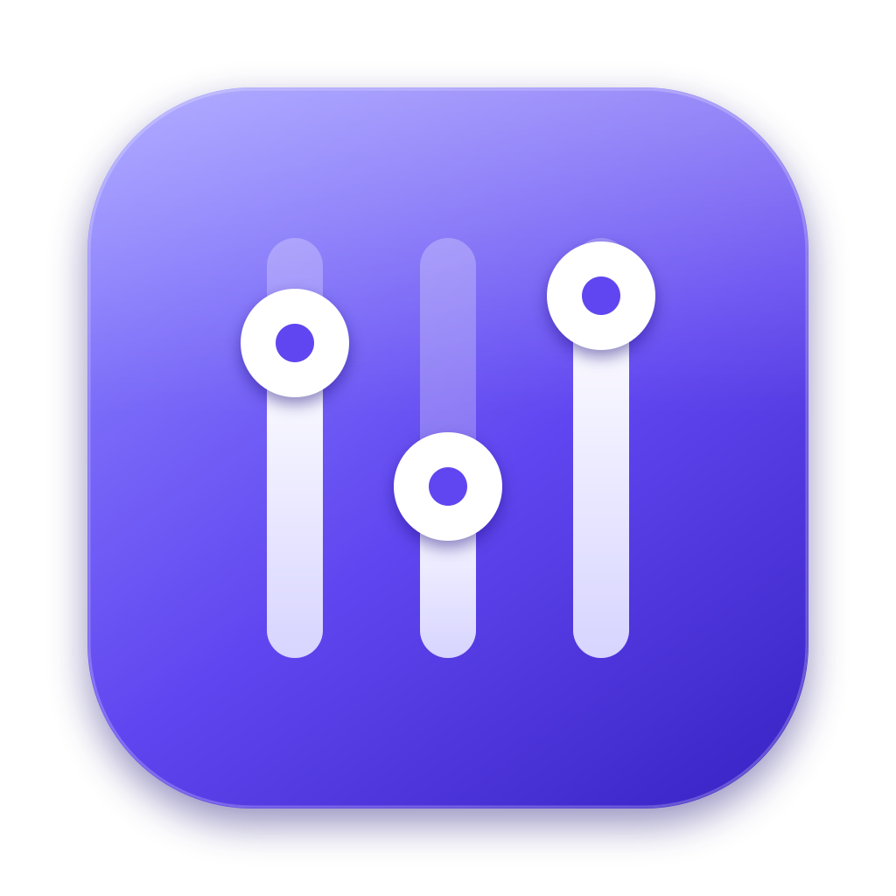
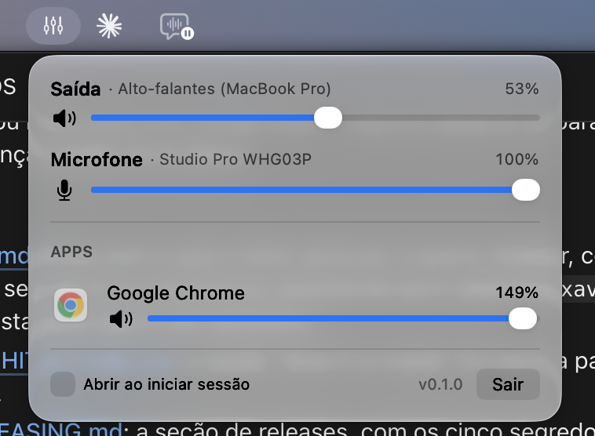

# SoundBar



[](https://github.com/evertonfxavier/soundbar-mac/actions/workflows/pipeline.yml)
[](LICENSE)

A volume mixer for the macOS menu bar.

<p align="center"></p>

- **Switch the speaker and the microphone** from the menu: the name of each device is a menu of the ones you have.
- **One slider per app** (and a mute button): turn Spotify down without touching the system volume. Up to 150%.
- **The microphone, in sight:** the menu bar icon turns into a microphone while any app uses it, and one click mutes it
  for everybody.
- **One slider per Chrome tab**, and the microphone of each tab, with the companion extension **SoundBar Bridge**.
- **A soundboard:** add your own sounds, give each an emoji or an image, and play them into a call so the other side hears
  them (needs the free [BlackHole](https://existential.audio/blackhole/) virtual microphone, see
  [The soundboard](#the-soundboard)).

The interface is in Portuguese.

## Install

Download the two files of the [latest release](https://github.com/evertonfxavier/soundbar-mac/releases/latest):

| File | What it is |
| --- | --- |
| `SoundBar-v<version>.dmg` | The app (macOS 14.2 or later, Apple silicon and Intel). Open it and drag SoundBar to Applications. |
| `SoundBar-Bridge-v<version>.zip` | The Chrome extension (Chrome 116 or later). Optional: only for per-tab control. |

**The extension:** unzip it, open `chrome://extensions`, turn on *Developer mode*, choose *Load unpacked* and pick the
unzipped folder.

**The first time:** SoundBar asks for *System Audio Recording* when you first change the volume of an app. That
permission is how it hears the apps it turns down.

**If macOS refuses to open the app** (a build that was not notarized, see [docs/RELEASING.md](docs/RELEASING.md)): run
`xattr -dr com.apple.quarantine /Applications/SoundBar.app` once, or use *System Settings > Privacy & Security > Open
Anyway*. A build that is not signed with a Developer ID is a different app to macOS every time, so it also asks for the
permission again after each update.

## Build it

You need the Xcode Command Line Tools (`xcode-select --install`), and for the extension Node 22+ and pnpm.

```sh
make app          # build/SoundBar.app
make run          # build it and (re)open it
make dmg          # build/SoundBar-v<version>.dmg
make extension    # ChromeExtension/dist, to load unpacked
make zip          # build/SoundBar-Bridge-v<version>.zip
make test         # the Swift tests and the extension's
make check        # what the pipeline checks: formatting, lint, types, tests, and the whole app compiling without warnings
make              # the rest of the targets
```

`./build.sh [--run]` still works. `scripts/build-app.sh` takes the version, the architectures (`ARCHS="arm64 x86_64"`)
and the signing identity (`SIGN_IDENTITY`) from the environment; each script says what it reads at the top.

### Why swiftc, and not the Swift Package Manager

The app is built by `swiftc` directly (`scripts/build-app.sh`), and its tests by `swiftc` too (`scripts/test.sh`, with
Swift Testing). The Command Line Tools of some macOS releases have a Swift Package Manager whose manifest library does
not even link, so a `Package.swift` would not work for the people who have no Xcode. The pipeline runs these same
scripts, so what is built on a laptop is what is built there. If you work in Xcode, a package can be added next to them.

## The soundboard

The **SONOPLASTIA** section of the menu is a grid of buttons, one per sound. Click one to play it; right-click to edit
or remove it; **+** adds a sound (any audio file of up to 30 seconds, a name, an emoji or an image as the icon, and a
volume). The sounds are kept in `~/Library/Application Support/SoundBar`. You always hear them on your own speakers.

**To have the other side of a call hear them**, macOS needs a virtual microphone to carry the sound, and SoundBar uses
[BlackHole](https://existential.audio/blackhole/) (free, open source):

1. Install it once: `brew install blackhole-2ch` (or the installer from the site), then restart the Mac or run
   `sudo killall coreaudiod`.
2. In the call app (Meet, Teams, Zoom, Discord…) choose **BlackHole 2ch** as the **microphone**. Leave the speakers as
   they are.
3. If you have more than one microphone (a headset and the Mac's), pick the one the sounds are mixed with in
   **Microfone dos sons** (in the same section). *Automático* follows the system's input.
4. That is all. While an app listens to BlackHole, SoundBar reads your real microphone, adds the sounds to it and
   writes the result to BlackHole; the menu says *Os sons vão para a chamada*. Your voice and the sounds both go through.
   When no app uses BlackHole, SoundBar does not touch your microphone.

The call app's own mute button mutes BlackHole, so it silences your voice and the sounds together.

## Known limits

**What it can and cannot separate**

- **Per app, not per window:** macOS shows one audio source per process. Two calls inside the Teams desktop app (or two
  windows of any one app) are one source, so they cannot be told apart. Teams only keeps one call live anyway; the
  other is on hold and silent. Two calls in two *browser tabs* are separate, with the extension.
- **Per Chrome tab needs the extension, and only Chrome is supported.** Other Chromium browsers may work with it, but
  are not tested; Safari and Firefox have no extension.
- **A tab's volume only goes down (0–100%)**, and only for sites that play through `<audio>` or `<video>`. A site that
  plays only through Web Audio ignores the slider; the tab's mute button works for every site.
- **A tab's microphone mute is silent to the site:** the call app keeps showing the microphone as on, while the other
  side hears silence. The mute of the whole microphone (the one in the menu) is the system's, and apps do notice it.
- **The soundboard needs BlackHole** and the call app set to use it. Meet, Teams and Zoom filter what is not a voice
  (noise suppression, echo cancellation), so a sound effect can come through softer, or cut, depending on the app; that
  is not something SoundBar can switch off. Discord does not do it to its own soundboard, and may to this one.
- The boost of an app above 100% (up to 150%) is limited to full scale, so a loud source can distort.

**How it works today**

- The *System Audio Recording* permission has no public API to ask about; `AudioCapturePermission` reads it the way
  the system does, through the private TCC framework. It works today, and may need a change in a future macOS.
- The extension needs the app: without it the tabs are listed nowhere and nothing is changed. It keeps trying to
  connect, so opening the app later is enough.
- The extension is installed by hand (*Load unpacked*), not from the Chrome Web Store: its content script runs on every
  site (`<all_urls>`), which the store reviews closely. Per-tab control needs that, because the volume is applied
  inside the page.
- The logic of the realtime audio path and of the bridge is tested; the taps themselves (a real device, a real
  permission) are not, and neither is the notarization.

## Documentation

- [Architecture](docs/ARCHITECTURE.md): how the app, the extension and the contract between them are made
- [Releasing](docs/RELEASING.md): versions, the pipeline, signing and notarization
- [Contributing](CONTRIBUTING.md) · [Security](SECURITY.md) · [License](LICENSE) (MIT)

Issues and pull requests are welcome. For a security problem, see [SECURITY.md](SECURITY.md) and do not open a public
issue.
